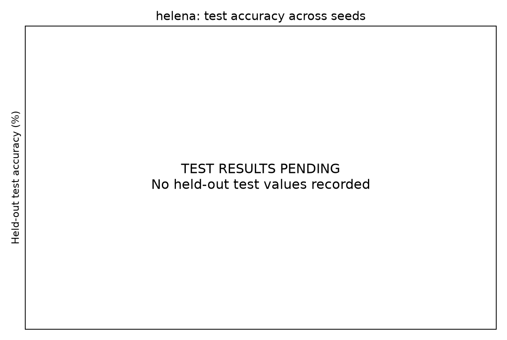
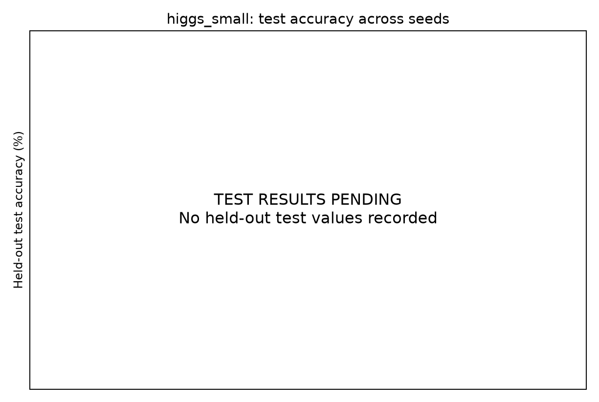
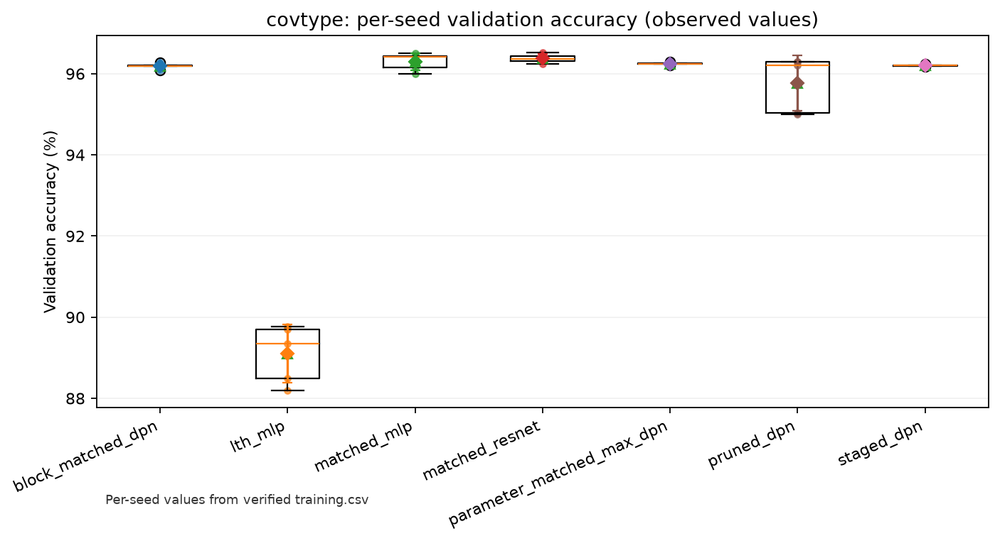
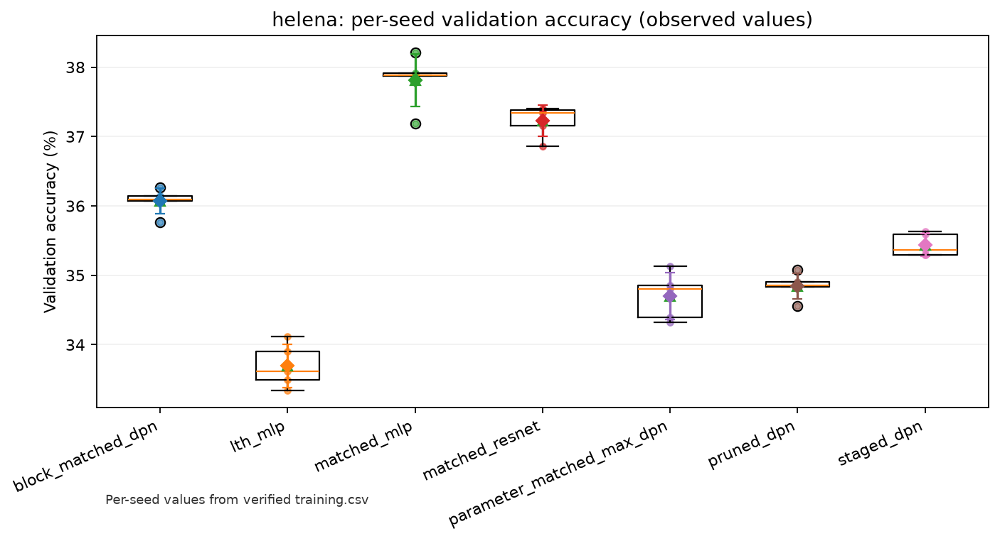
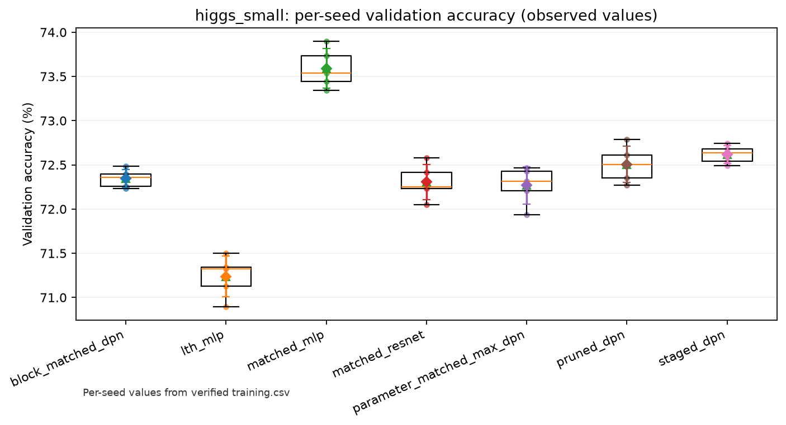
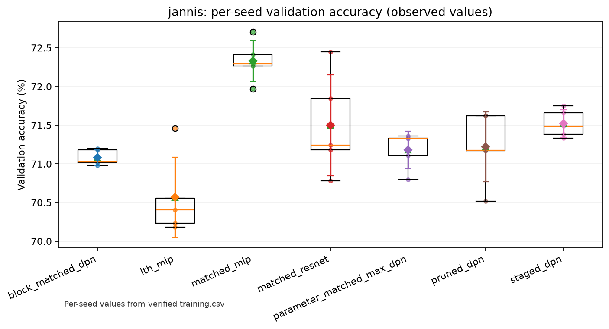

# Validation and test accuracy plots

Figures use per-seed test accuracy values from `../csvs/training.csv`. The box spans the interquartile range, the line is the median, and the diamond marks the mean. Orange bars mark mean ± sample SD. A dataset without test scores shows an explicit **pending** figure.

## covtype

## helena

## higgs_small

## jannis

# Validation accuracy figures

Before per-seed migration, validation figures show the paper-author supplied rounded mean and SD, not synthetic seed values. After import, they use actual per-seed observations.

## covtype: validation

## helena: validation

## higgs_small: validation

## jannis: validation

